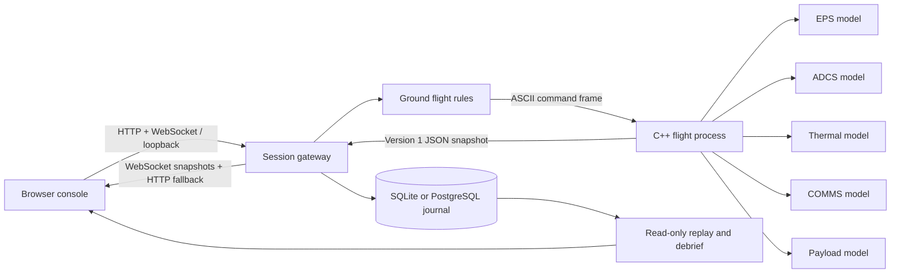

# Architecture and design rationale

## System boundary

Each session has an isolated child process and simulation seed. The browser never edits the flight state. A command first passes schema and role checks, then ground flight rules, then onboard acceptance. The C++ process owns physical state and fault protection. Administrative fault injections are explicitly local lab controls that bypass the simulated radio link, not operational uplink commands.

The same console serves two products: FlightStack explains and tests onboard behavior; MissionOps controls, records, and reconstructs behavior. A single repository keeps their shared ICD and evidence synchronized. The flight process also runs standalone.

## Components and models

- **EPS:** 20 Wh effective capacity, 12 W generation in sunlight; base load 3 W in SAFE or 5 W otherwise, 1 W for enabled ADCS, 8 W for payload, 4 W for heater. SOC increment = net watts / 720 percentage points per simulated second. Voltage is a linear illustrative 6.0–8.4 V mapping. Undervoltage injection forces SOC to 15% and drains 0.25 percentage points/second until cleared.
- **ADCS:** one attitude axis, degrees and degrees/second; a clipped proportional/damping controller, simple wheel response, xorshift32 seeded perturbations. Not a quaternion estimator, rigid-body model, sensor fusion algorithm, or physically calibrated actuator model.
- **Thermal:** first-order relaxation to 24°C sunlight / 4°C eclipse with 500 s time constant, plus payload/heater/fault terms. No radiative heat balance, orbital environment, or thermal-vacuum validation.
- **COMMS:** simulated connected state and age. No RF framing, bandwidth, noise, propagation delay, TCP/UDP spacecraft transport, or real spacecraft connection.
- **Payload:** accumulating data at 0.25 MB/s while active; no actual instrument or data downlink.
- **Scheduler:** one deterministic 1 s logical step. The UI can request accelerated batches. Injected missed deadlines are counters, not actual host deadline measurements.
- **Mode/FDIR:** BOOT, NOMINAL, SAFE, RECOVERY, resource interlocks, six injected fault categories. Protection runs at each simulated second and immediately for most injected critical faults. COMMS loss trips at 15 simulated seconds.

## State and recovery

A critical fault forces SAFE and shuts down payload/heater. Recovery requires no active fault sources, SOC ≥35%, temperature <45°C, sensor age <2 s, absolute wheel speed <5500 rpm, connected COMMS, and 10 simulated seconds of uninterrupted health. Clearing faults changes sources only; battery/temperature/wheel state must independently recover. `DESATURATE` is required after a wheel fault is cleared.

SAFE remains latched until a valid RECOVER command. RECOVERY remains until a valid RESUME. There is no automatic return to payload operations. Calling SAFE is allowed from any mode and is idempotent with respect to mode.

## Concurrency and storage

`Mission.lock` serializes step, command, procedure and snapshot operations. The shared journal uses a separate lock and parameterized SQLite queries. Server-side commands run synchronously; a flight exchange has a two-second wall-time acknowledgment deadline. If the child dies or times out, the mission becomes failed and stops advancing; start a new session to recover the service.

SQLite WAL persists run metadata, telemetry received over the simulated link, requests, transmissions, terminal command outcomes, procedure actions, and simulation controls. Onboard event windows are carried inside snapshots. The journal is append-only via application APIs, not cryptographically tamper-evident. Replaying a record never transmits commands.

## Key decisions

1. Standard-library Python and dependency-free browser assets: no package installation or vendor service is required for this local release.
2. Local process transport: simple, observable, and reproducible; explicitly not a distributed network benchmark.
3. SQLite instead of PostgreSQL: zero setup and durable single-host operation; not representative of production ground station scaling.
4. Fixed-step deterministic simulation: identical same-seed runs on the measured host; floating-point equivalence across architectures is not assumed.
5. No AI in flight decisions: all authority belongs to deterministic rules and explicit operator actions.
6. No framework branding: F Prime/Open MCT remain unimplemented until real adapters, builds, and tests exist.

## Framework integration and process boundaries

The F Prime FlightComputer component owns the same model used by the standalone executable. Generated FPP command decoding routes through the model's guards; connected typed ports publish 26 scalar channels plus mode and terminal command responses. The Bridge exposes this generated dispatch to isolated MissionOps sessions. The separate AsteriaDeployment wires FlightComputer to F Prime command, telemetry, event and 1 Hz scheduling services. These are two execution modes; the console does not pretend to exercise the deployment's TCP/CCSDS transport.

One wrapper is deliberate: five logical subsystem models share tightly coupled state, while FDIR observes the complete spacecraft atomically. This revises the proposal's eight-component target. Further decomposition would require an explicit synchronization/state-ownership design.

The gateway uses strict Pydantic schemas and a monotonic scheduler. Each session has one child process and lock; the service caps active sessions at eight. WebSocket sends are bounded by a timeout and do not accumulate an unbounded outbound queue. The journal is append-only through this API; it is not a tamper-proof ledger. HTTP exports freeze an upper record ID, then page records to avoid silently truncating an active mission.

Open MCT uses UTC-projected simulation time (mission epoch plus elapsed simulation seconds), with a `utc` domain key matching its time system. Live updates and historical data share the same channel identifiers. The custom console retains guarded controls, procedural recovery and debrief generation.
